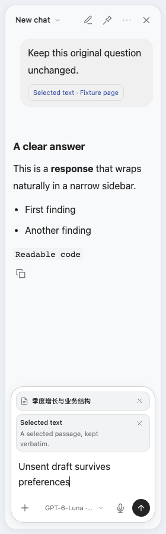
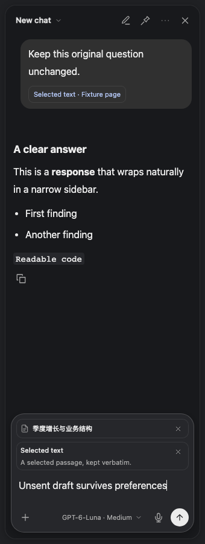

# Safari Codex Bridge

A Safari sidebar for asking questions about the page you are reading — text, selected passages, images and charts — through your own Codex account. Switch to Work for scoped file and code tasks.

[简体中文](README.zh-CN.md) · [Build & install](docs/INSTALL.md) · [Privacy](PRIVACY.md) · [Security](SECURITY.md)

**Independent community project. Not an official OpenAI, Apple or Google extension.** Source and an optional **ad hoc signed test package** are available in [Releases](https://github.com/jianqilingyun/safari-codex-bridge/releases/latest). The test package is **not notarized**, requires Safari developer settings, and has not been validated end to end on a fresh Mac. See [test-package installation notes](docs/AD-HOC-INSTALL.zh-CN.md). For regular local use, build with your own Apple signing identity.

## Features

- Switch the companion window between Simplified Chinese and English; the choice persists and also changes its menu-bar menu. Sidebar language remains independently selectable.

- Chat alongside the current webpage, with streaming answers and follow-up questions.
- Attach selected text, page text, a visible screenshot, or up to three additional authorized tabs. Review or remove references before sending.
- Search the web through the official Codex search tool, with source links. Search is enabled by default and can be turned off.
- Switch between webpage Chat and **Work**. Start directly in an automatically created per-chat folder, process files, run code and generate artifacts. Choose an existing folder only when your task needs it. Protected operations appear as explicit approvals in the sidebar; inspect the operation log and use **Files** to reveal the working folder.
- Discover models and reasoning efforts from the official Codex app-server; unavailable models produce an error rather than silently switching.
- Save chats by default in Codex history; reopen them or continue in the Codex desktop app. Temporary chats are optional.
- Pin the sidebar on authorized websites, resize down to 280 px, choose Chinese or English UI, light/dark/system appearance, and 12–20 px text.
- Dictate using the official Codex desktop global shortcut. The microphone button dispatches the shortcut; Codex handles audio and transcription. No Apple speech-recognition fallback or private transcription endpoint.
- Optional read-only MCP tools let an existing Codex chat inspect explicitly requested Safari content.

## Preview

<p> </p>

Synthetic test pages and mocked replies; these previews show layout, not a live model session.

## Requirements & installation

macOS 13+, Safari, full Xcode, Python 3.9+, and an installed, signed-in official Codex desktop app or CLI that supports `app-server`. Model access and usage limits are determined by your own account. The bridge does not provide a subscription or API credentials.

Follow [the installation guide](docs/INSTALL.md). For a compile-only check:

```sh
git clone https://github.com/jianqilingyun/safari-codex-bridge.git
cd safari-codex-bridge
./scripts/build.sh --unsigned
```

An unsigned build is for development checks, not a ready-to-install public package. To use the extension, build with **your own Apple signing identity**. To distribute a normal downloadable macOS installer, Developer ID signing and notarization are a separate release step; see [Apple’s distribution documentation](https://developer.apple.com/documentation/safariservices/distributing-your-safari-web-extension).

## How it works

```text
Safari page → isolated sidebar / content collector
            → Safari native extension → local app-group mailbox
            → background helper → official Codex app-server (stdio)
            ← streamed responses ← your Codex account
```

The helper discovers the installed official runtime and checks its protocol before use. It does not redistribute an OpenAI executable, copy login tokens, or automate the ChatGPT website. Chat and Work use separate runtime profiles. Chat keeps local file/code tools disabled. Work enables core file/code tools with workspace-write sandboxing and on-request approvals, overrides inherited writable roots on every turn, and accepts only a current, explicitly approved operation. Both profiles disable inherited MCP servers and optional agents/apps/plugins. Read access follows the official sandbox and macOS permissions; the working folder is not a filesystem read-isolation guarantee. Webpage material is labeled as untrusted reference content.

The integration uses the documented [Codex app-server](https://learn.chatgpt.com/docs/app-server) interfaces. Runtime discovery, dynamic model lists and compatibility checks reduce update coupling; future protocol or desktop shortcut changes may still require a bridge update.

## Scope and limitations

- Work exposes the official core local tools, not every ChatGPT web/desktop feature. Connectors, computer/browser control, agent delegation, image generation and specialized ChatGPT modes are not exposed in this release.
- Once a temporary chat has started, its mode, search setting and folder are fixed; start a new temporary chat to change them. Saved chats can be reconfigured between turns.
- Safari has no Chrome-style extension side-panel surface in this implementation. The sidebar uses a closed Shadow DOM inside the webpage; unusual site layouts can still interfere.
- It reads loaded content. It cannot retrieve inaccessible subscription articles, hidden cross-origin frames, or an entire long page from a viewport screenshot.
- A screenshot can include private information currently visible on screen. Check context before sending. See [Privacy](PRIVACY.md).
- Private tabs and browser-internal pages are excluded. Safari controls website access; a site-specific Deny overrides the general Allow setting.
- Dictation is a shortcut bridge, not a direct speech API. It requires the Codex desktop app running, a matching Single tap shortcut, and helper Accessibility permission. The bridge cannot observe Codex’s actual recording state. If recording is stopped externally, its local microphone indicator can become stale; use the official Codex controls to reconcile it.
- English UI is available; the initial assistant instructions default to Chinese. You can ask for another response language.
- No claim of compatibility with every macOS/Safari/Codex version. Intel is compile-checked; real browser acceptance so far was on Apple Silicon.

## Development

```sh
npm ci
npx playwright install chromium
npm run test:python
npm test
```

On macOS, `./scripts/build.sh --unsigned` checks both arm64 and x86_64. See [CONTRIBUTING](CONTRIBUTING.md) for Swift and opt-in live tests. Automated browser tests use synthetic pages and mocked extension transport; they do not prove real Safari permissions, cloud answers or microphone transcription.

## License

Original project code: [MIT](LICENSE). Bundled Mozilla Readability retains its [Apache-2.0 notice and license](THIRD_PARTY_NOTICES.md). OpenAI, Apple, ChatGPT and Codex names identify external products; their software and services are not covered by this project’s MIT license.
